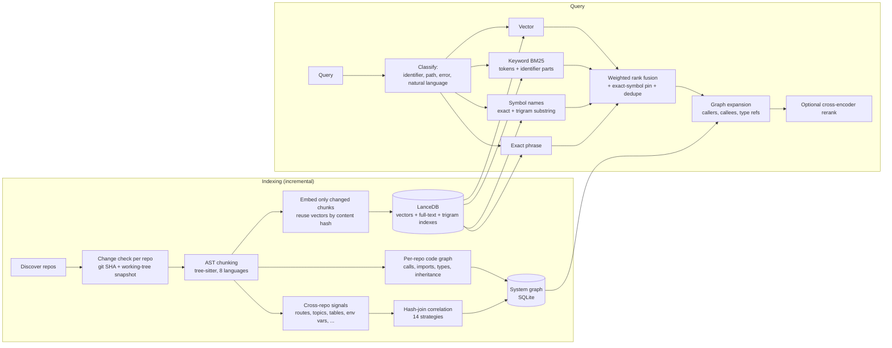

# code-search-mcp

[](https://www.npmjs.com/package/@esankhan3/code-search-mcp)
[](./LICENSE)

**Code search for AI agents, across every repository you own.**

`code-search-mcp` is a Model Context Protocol server that indexes many
repositories at once and gives any MCP client (Claude Code, Claude Desktop,
Cursor, or your own agent) three things that `grep` and plain vector search
can't:

- **Hybrid search that finds the right code.** It handles exact identifiers,
  partial names, error strings and plain-English questions in one query path.
- **A code graph.** Agents can see callers, callees, call chains, dead code,
  and the blast radius of a diff.
- **A system graph across repositories.** It links the HTTP routes, gRPC
  services, Kafka topics, database tables, env vars and shared types that
  connect your services, so "who consumes this topic?" has an answer.

It runs on a laptop over stdio, or as a shared HTTP server for a whole team.
It is tested at over a million indexed code chunks.

```sh
npm install -g @esankhan3/code-search-mcp
ollama pull bge-m3                                   # or use an OpenAI / Voyage / Mistral key
claude mcp add code-search -- code-search-mcp --local ~/code
```

That's it. Your agent now knows your codebase. The **[step-by-step guide](./RUNNING.md)**
covers every way to run it.

---

## Contents

- [What your agent can ask](#what-your-agent-can-ask)
- [Quick start](#quick-start)
- [Tools](#tools)
- [How it works](#how-it-works)
- [Performance at scale](#performance-at-scale)
- [Ways to run it](#ways-to-run-it)
- [Configuration](#configuration)
- [Security and operations](#security-and-operations)
- [Supported languages](#supported-languages)
- [Design principles](#design-principles)
- [Development](#development)

---

## What your agent can ask

| Question | Tool the agent reaches for |
|---|---|
| "Where do we verify JWTs?" | `search_code`: semantic + keyword + symbol search, fused |
| "Find `CompanySearchResponse`." / "Anything named `*SearchResponse`?" | `search_exact`: exact and partial identifier match, no embedder needed |
| "Who calls `createInvoice`, and from which repos?" | `find_callers` |
| "If I change `billing/tax.ts`, what breaks?" | `impact_analysis` (follows dependents across repos) |
| "What does this diff touch?" | `detect_changes`: diff hunks → changed entities → their dependents |
| "How does a request get from `checkout` to `ledgerWrite`?" | `trace_path`: shortest call chain |
| "Which services read the `orders.created` topic?" | `get_cross_repo_edges` |
| "What does this repo do and how is it laid out?" | `get_repo_profile` / `get_architecture` |

---

## Quick start

**1. Install.** Requires Node.js 20 or newer and `git`.

```sh
npm install -g @esankhan3/code-search-mcp
```

This installs three commands: `code-search` (CLI), `code-search-mcp`
(MCP server) and `code-search-daemon` (watch-and-reindex).

**2. Pick an embedder.** The default (`auto`) uses the first one it finds:

| You have | It uses |
|---|---|
| `CODE_SEARCH_EMBEDDING_BASE_URL` set | any OpenAI-compatible endpoint |
| Ollama running locally | Ollama, model `bge-m3` (fully offline) |
| `MISTRAL_API_KEY` | Codestral Embed |
| `OPENAI_API_KEY` | OpenAI |
| `VOYAGE_API_KEY` | Voyage |
| `GEMINI_API_KEY` / `GOOGLE_API_KEY` or a logged-in Gemini CLI | Gemini |

**3. Index and query from the terminal.**

```sh
code-search index ~/code --project acme       # one repo, or a folder full of repos
code-search query --project acme "where do we retry failed webhooks"
code-search query --project acme "WebhookRetryPolicy" --mode bm25
```

**4. Connect your MCP client.**

```sh
# Claude Code
claude mcp add code-search -- code-search-mcp --local ~/code --project acme
```

```jsonc
// Claude Desktop (claude_desktop_config.json) or Cursor (~/.cursor/mcp.json)
{
  "mcpServers": {
    "code-search": {
      "command": "code-search-mcp",
      "args": ["--local", "/Users/me/code", "--project", "acme"]
    }
  }
}
```

The guide covers team servers, Docker, GitHub orgs, object storage and
troubleshooting: **[RUNNING.md](./RUNNING.md)**.

---

## Tools

Seventeen tools in four groups. Every tool validates its arguments against
its schema and returns `isError: true` with a reason when they are wrong.

### Search

| Tool | What it does |
|---|---|
| `search_code` | Hybrid search: vector + keyword + symbol + phrase tiers, fused, then expanded through the code graph and optionally reranked |
| `search_semantic` | Vector-only: paraphrases and intent |
| `search_exact` | Literal search led by exact and partial symbol-name and exact-phrase hits; works without an embedder |
| `get_code_snippet` | The source of one entity by name, cheaper than reading the whole file |

### Graph

| Tool | What it does |
|---|---|
| `find_callers` / `find_dependencies` | Who calls a symbol, and what it calls. `calls` edges by default; `relations` adds imports, uses, type refs and inheritance |
| `trace_path` | Shortest call chain between two symbols, or everything reachable from one |
| `impact_analysis` | Dependents of a file or entity, up to 5 hops, across repositories |
| `detect_changes` | Maps a git diff to the entities whose lines changed, plus their dependents |
| `search_graph` | Structural query: nodes by name (regex), type, file or repo, ranked by connectivity |
| `find_dead_code` | Entities nothing references (heuristic) |
| `get_repo_graph` | One repository's entities and edges |
| `get_cross_repo_edges` | Links between repositories, each with the evidence that produced it |
| `get_architecture` | Project overview: repository roles, key flows, connections |

Symbols are matched by exact name or full `repo::file::entity` id.
`fuzzy: true` matches a case-insensitive substring. Multi-hop traversals are
bounded (50k nodes, 1 s), so a hub symbol in a large org gets a partial
answer that says so, never a hang.

### Profiles and index

| Tool | What it does |
|---|---|
| `list_repos` / `get_repo_profile` | Each repository's tech stack, structure and entry points |
| `index_status` | Chunks per repo, embedder, last index time, vector-index health |

Plus MCP resources: `code-search://repos`, `code-search://system-graph`,
`code-search://repo/{name}/profile`, `code-search://repo/{name}/graph`.

---

## How it works



**Chunks follow the code's structure.** Files split at definition boundaries
(functions, classes, methods, top-level constants), not every N lines. Each
chunk carries a context prefix (file path, module and imports) that is
embedded with it.

**Four retrieval tiers run in parallel.** Vector search catches intent.
BM25 runs over the raw tokens and over the parts of compound identifiers, so
"expected backlog count" finds `verifyExpectedBacklogCount`. A symbol tier
matches entity names exactly and as substrings through a trigram index, so
`SearchResponse` finds `CompanySearchResponse`. A phrase tier matches error
strings word for word. A query classifier weights the tiers per query:
identifiers lean on keywords, questions lean on vectors.

**The graph does more than draw diagrams.** It feeds retrieval (seed hits pull in
their callers and callees) and answers structural questions directly.
Cross-repository edges come from 14 detectors: npm and workspace
dependencies, shared types, env vars, Kafka and other topics, HTTP routes
(including template-literal client URLs), gRPC services, database schemas,
Redis keys, S3 buckets, OpenAPI contracts, docker-compose and Kubernetes
service references, and shared constants.

**The index maintains itself.**
- Each cycle touches only what changed:
  - repositories are checked concurrently;
  - only changed files are re-chunked;
  - only chunks whose text changed are re-embedded;
  - the system graph is updated in place.
- The vector index retrains itself as the corpus grows.
- The number of IVF partitions probed per query is auto-calibrated to hit
  0.95 recall against an exact scan.
- The embedder is pinned per index: querying with a different model or
  dimension size is an error, never silently wrong results.

---

## Performance at scale

Measured on one 12-core laptop, over 1.15 million chunks across 360
repositories, with 600 mixed queries (exact identifiers, partial names,
natural language and phrases). The corpus was built by replicating real
repositories. A stub embedder was used, so the timings exclude
embedding-provider latency.

| | |
|---|---|
| `search_code` latency (p50, 1 client) | **36 ms** |
| `search_exact` latency (p50, 1 client) | **17 ms** |
| Throughput, 8 concurrent clients | **26 q/s** (`search_code`), **39 q/s** (`search_exact`) |
| Vector recall@10 vs exact scan (auto-calibrated) | **0.977** |
| Re-index, nothing changed | **~15 s** |
| Re-index after a one-file edit (chunks, graph, embeddings) | **~30–70 s** |
| Cross-repository edges in the system graph | **454k** |

On the same queries, the expected file ranked in the top 10 for 100% of
exact-identifier queries in both search tools. For natural-language
questions it was 91% with `search_code` and 80% with `search_exact`.

---

## Ways to run it

| Mode | Command | Use it for |
|---|---|---|
| **Local, stdio** | `code-search-mcp --local ~/code` | One developer; the index lives on your machine |
| **GitHub org** | `code-search-mcp --local "github:my-org/api-*"` | Clone or refresh matching repos, then serve them |
| **Team server** | `code-search-mcp --serve ~/code --auth api-key` | One index for everyone, over Streamable HTTP at `/mcp` |
| **Remote proxy** | `code-search-mcp --remote https://search.internal` | A thin local stdio bridge to a team server; nothing indexed locally |
| **Daemon** | `code-search-daemon --workspace ~/code` | Watch files and re-index on change; the CLI queries it over a local socket |
| **Docker** | `docker build -f Dockerfile.all-in-one …` | One image with Ollama, the embedder and reranker models baked in |

The team server binds its port before the first index runs, so health
probes answer immediately (`/ready` is 503 until the index can serve).
It serves every `/mcp` request statelessly, which makes restarts free and
lets it scale across cores with `CODE_SEARCH_WORKERS=N`. In that mode one
primary does all writes and N workers serve.

For stateless pods, vectors can live in S3 or MinIO (`s3://` LanceDB URIs) and
index artifacts in MongoDB. See [RUNNING.md § Object storage](./RUNNING.md#9-stateless-deployments-object-storage).

---

## Configuration

Five layers, lowest to highest precedence:

1. built-in defaults
2. `~/.code-search/config.yaml` (per user)
3. `<workspace>/.code-search.yaml` (per workspace)
4. `CODE_SEARCH_*` environment variables
5. CLI flags: any setting as `--<dotted.path> <value>`, e.g. `--retrieval.max-chunks 12`

`code-search --print-config` prints the resolved result with secrets
redacted. An unknown flag exits with status 2 instead of being ignored.

```yaml
# .code-search.yaml
embedding:
  provider: openai          # auto | ollama | openai | voyage | codestral | openai-compatible | gemini-oauth | custom
  model: text-embedding-3-small
  dimensions: 1536
reranker:
  provider: none            # ollama (default, qwen2.5-coder:7b) | cohere | voyage | openai-compatible | none
retrieval:
  max_chunks: 12
indexing:
  reindex_interval_ms: 1800000   # team server: re-index every 30 min
```

| Variable (`CODE_SEARCH_…`) | Purpose |
|---|---|
| `EMBEDDING_PROVIDER` / `_MODEL` / `_DIMENSIONS` / `_API_KEY` / `_BASE_URL` | Embedder |
| `RERANKER_PROVIDER` / `_MODEL` / `_API_KEY` / `_BASE_URL` | Reranker (`none` to disable) |
| `DATA_DIR` | Where indexes live (default `~/.anvil/knowledge-base`) |
| `PORT` / `HOST` | HTTP bind (default `127.0.0.1:3100`) |
| `AUTH_MODE` / `AUTH_API_KEYS` / `AUTH_JWT_SECRET` | `none` / `api-key` / `jwt` |
| `REINDEX_INTERVAL` | `30m`, `1h`, `6h` or `0` |
| `WORKERS` | HTTP worker processes (2–16) |
| `SERVER` / `API_KEY` | Remote-proxy target and its key |
| `VECTOR_NPROBES` | Fix IVF probes per query (overrides auto-calibration; lower = faster, less recall) |
| `STORAGE_VECTOR_URI`, `STORAGE_BLOB_BACKEND`, `STORAGE_MONGO_*`, `STORAGE_S3_*` | Object-storage deployment |

The full list is in [RUNNING.md § Configuration reference](./RUNNING.md#configuration-reference).

---

## Security and operations

- **Auth.**
  - `none`: binds to `127.0.0.1` only.
  - `api-key`: `Authorization: Bearer …`, compared in constant time.
  - `jwt`: HS256; signature, issuer and a required `exp` are verified, plus `nbf` when present. The server refuses to start without a secret.
  - A public bind without auth logs a warning.
- **Limits.** A per-identity sliding-window rate limit (default 100/min).
  Per-project scopes and query quotas come from
  `<dataDir>/projects/<name>/project.yaml`.
- **Endpoints.**
  - `GET /health`, `/ready`, `/version`, `/status`.
  - `GET /metrics`: Prometheus metrics for query counts, latency histogram, errors, index age, chunks per repo and vector-index health.
  - `GET /admin/api/status`.
  - `POST /index`: re-index on demand.
- **Logs and tracing.** `CODE_SEARCH_STRUCTURED_LOGS=1` emits JSON log lines.
  Query text is kept out of traces unless you opt in with
  `CODE_SEARCH_TELEMETRY_RECORD_QUERIES=1`.

---

## Supported languages

| Support | Languages / files |
|---|---|
| AST chunking, code graph, cross-repo signals | TypeScript, TSX, JavaScript, Python, Go, Java, Rust, PHP |
| Indexed for search | the above, plus shell, YAML, Terraform/HCL, TOML, `Dockerfile`, `Makefile`, `Jenkinsfile` |

`.gitignore` is respected, and `node_modules`, `dist`, `build`, `vendor`,
`target` and similar directories are skipped.

---

## Design principles

- **Multi-repo first.** The interesting questions cross repository
  boundaries, so the index, the graph and the tools all do too.
- **Scale by doing less.** Every index cycle costs in proportion to what
  changed, not to the size of the corpus. Every query tier is index-backed.
  Every graph traversal is bounded.
- **Never silently wrong.** An embedder mismatch is a hard error. Truncated
  traversals say they were truncated. Bad tool arguments return the reason.
- **Local by default, shared when you want.** The same binary serves one
  laptop over stdio or a whole team over HTTP.
- **Few moving parts.** Embedded LanceDB and SQLite, no database server to
  run, a hand-rolled HTTP layer and zero-dependency metrics.

---

## Development

This package lives in a monorepo alongside its retrieval engine,
`@esankhan3/anvil-knowledge-core`.

```sh
npm install                                        # at the repo root
npm -w @esankhan3/anvil-knowledge-core run build
npm -w @esankhan3/code-search-mcp run build        # esbuild bundle → dist/
npm -w @esankhan3/code-search-mcp test
npm -w @esankhan3/code-search-mcp run smoke        # end-to-end, needs Ollama with bge-m3
```

Internals: [ARCHITECTURE.md](./ARCHITECTURE.md). Retrieval engine:
[knowledge-core](../knowledge-core/ARCHITECTURE.md).

## License

[MIT](./LICENSE)
